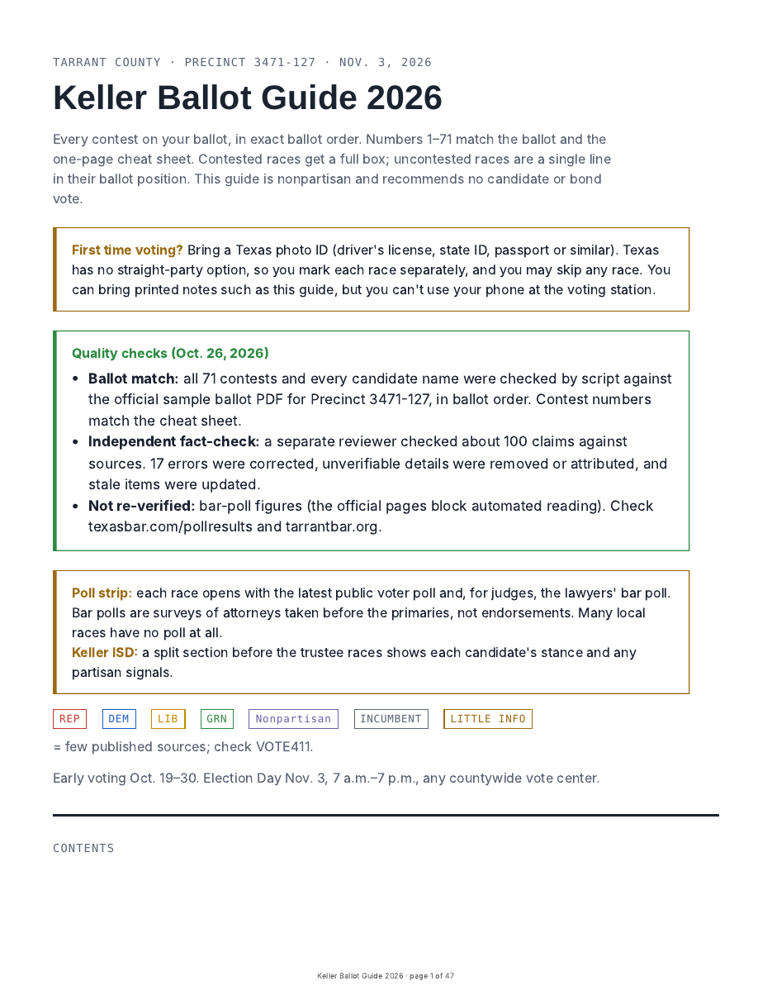
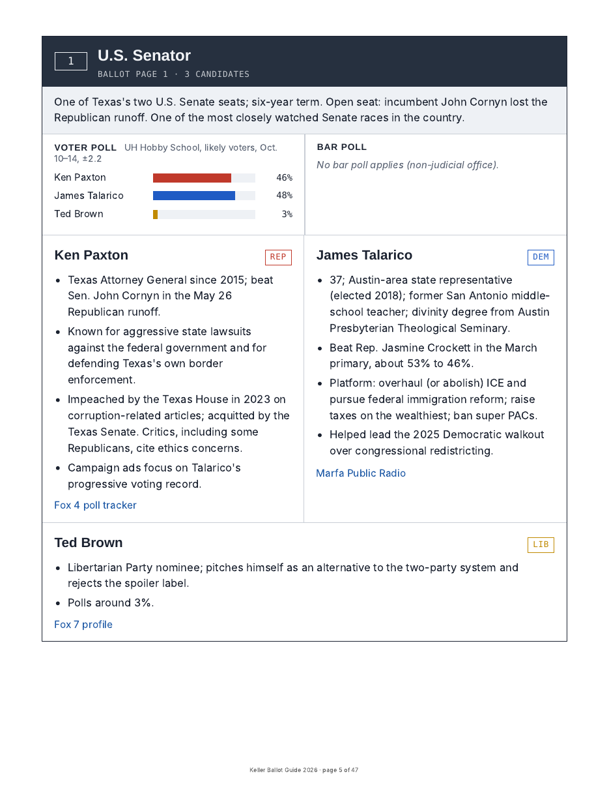
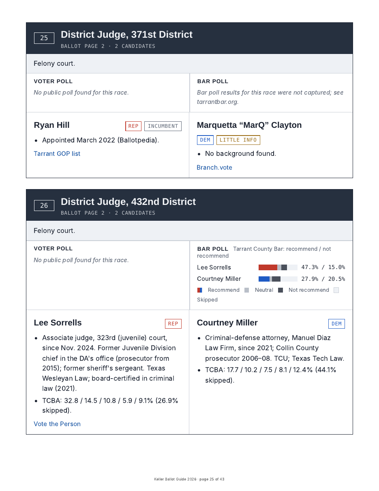
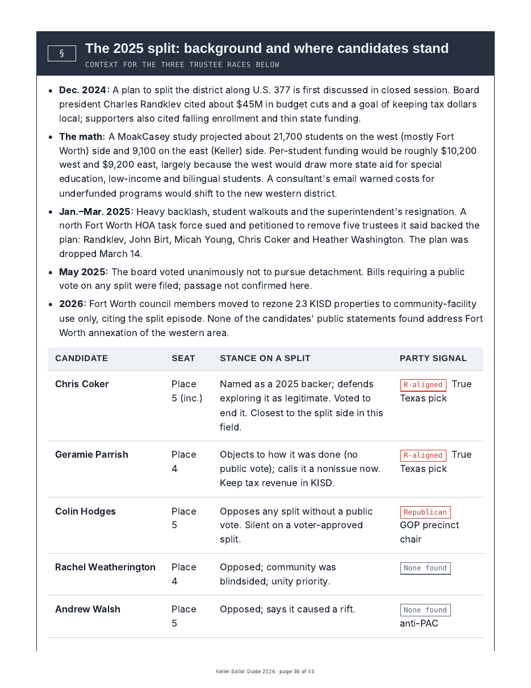
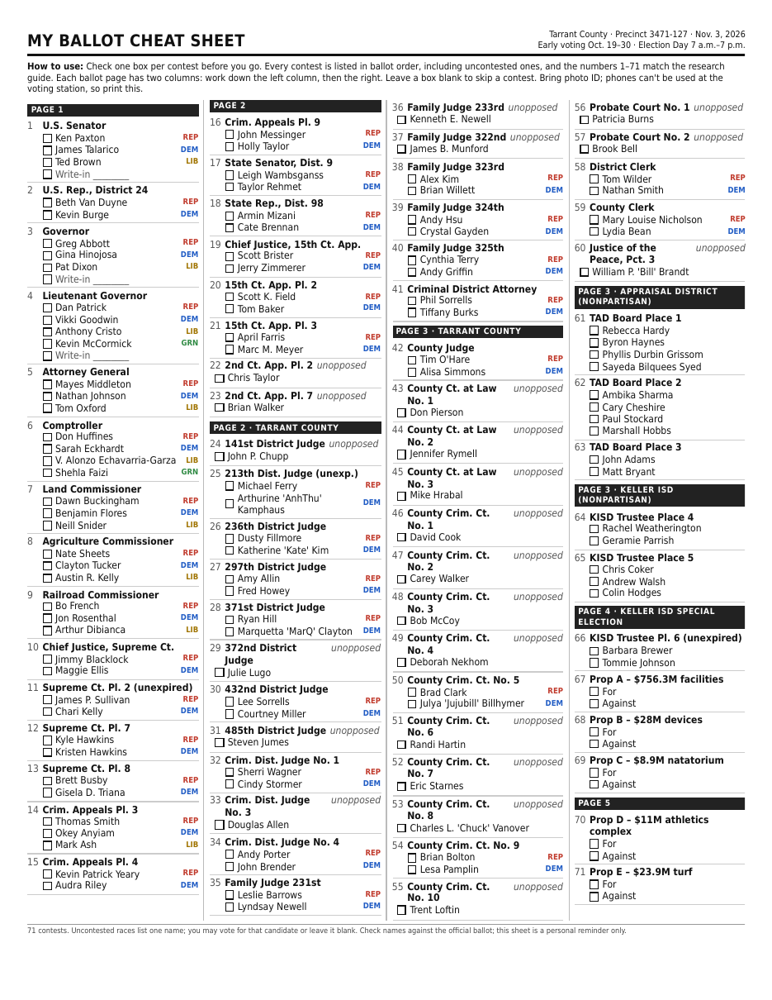
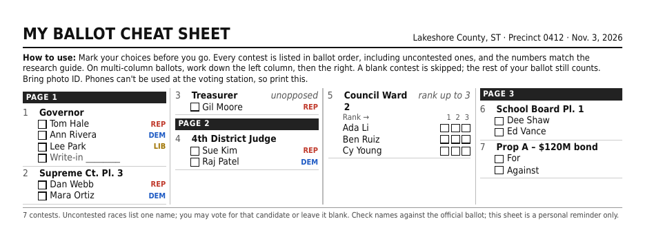

# InformedVoter

**Awesome Claude-assisted Election Research Guide and Ballot Cheat Sheet**

A [Claude](https://claude.ai) skill that turns your **sample ballot** into two things:

1. **A nonpartisan research guide.** Every contested race on your ballot, in ballot order, one clearly separated box per race. Each box has polls, candidate backgrounds, positions, endorsements and links. You get it as a shareable web page and a PDF.
2. **A one-page ballot cheat sheet.** Every contest on your ballot, including uncontested ones, in exact ballot order with checkboxes. Mark it in pen ahead of time and bring it with you to vote.

It works for any U.S. state, county or city. Each guide also opens with **that state's voting rules for that election**: ID, early-voting window, Election Day hours, and phone and note rules. There's a fuller version for first-time voters.

> **Not exhaustive. Not advice.** This tool helps you start your research. It does not replace your own. See [Limitations](#limitations).

---

## What it looks like

These examples come from a real November 2026 ballot (Tarrant County, Texas, Precinct 3471-127). All of it is public information.

| Guide cover and voting basics | A race box with its poll strip |
|---|---|
|  |  |

| Judicial races with bar-poll ratings | Local issue tracker (school-district split) |
|---|---|
|  |  |

**One-page cheat sheet** (71 contests, uncontested ones included, in ballot order):



The cheat sheet also handles ranked-choice grids, write-ins and ballot measures. This is the fictional sample:



Full PDFs are in [`examples/`](examples/).

---

## What it covers

**For every contested race**
- A plain-language description of what the office does. For example, the Texas Railroad Commission regulates oil and gas, not railroads.
- **Candidates:** background, incumbency, platform, notable endorsements from across the spectrum, money raised where reported, documented controversies from credible outlets, and links (campaign site, social media, Ballotpedia, VOTE411, local news Q&As).
- **A poll strip:**
  - **Voter polls:** the latest public polls, with pollster, dates and margin of error.
  - **Bar polls for judges:** state and local bar association surveys, shown as vote counts or stacked recommend/neutral/not-recommend bars.
- **Thin-information flags:** when little is published about a candidate, the guide says so rather than filling the gap.

**Local issues you care about**
- You name a local controversy, such as a school-district split, a bond, annexation or rezoning. The guide documents each candidate's on-record stance in a timeline and a stance table.
- Optionally, it notes **party signals** for nonpartisan races. These come only from public party roles and partisan-group endorsements, never from voter files.

**Ballot measures and bonds**
- A neutral summary, the sponsor's rationale, organized support and opposition, and the stated fiscal impact along with its assumptions.

**State-specific voting rules**
Verified each time against official state and county election offices:
- ID rules and registration deadlines, including same-day registration
- Early-voting dates and Election Day hours
- Vote centers versus assigned polling places, and all-mail states
- Mail-ballot deadlines
- Straight-ticket voting and ranked-choice voting
- Phone and note rules in the booth, and electioneering buffer zones

**One numbering system:** every contest carries its ballot position (1, 2, 3 …) in both the guide and the cheat sheet. Uncontested races appear as one-line entries in their place, so numbers never skip or shift.

**Color key:** Republicans red · Democrats blue · Libertarians gold · Greens green · Independents and other parties purple · Nonpartisan slate.

---

## Quality checks

The skill doesn't deliver anything until these gates pass. Their results print in a **Quality checks** box at the top of every guide.

1. **Ballot match (automated).** [`verify_ballot.py`](ballot-research-guide/scripts/verify_ballot.py) reads the official sample-ballot PDF column by column, ignoring "SAMPLE" watermarks. It then confirms that:
   - every candidate name in the data is printed on the ballot (catching invented or misspelled names);
   - contests and names are in ballot order;
   - nothing on the ballot was left out;
   - the guide and the cheat sheet both number contests 1..N, with the right candidates under each number.

   Any error blocks delivery.
2. **Every fact has a source.** Each candidate fact, poll and dollar figure must link to a source looked at during the session. Anything unsourced is removed or marked unverified.
3. **Independent fact-check.** A separate reviewer agent, with no drafting context, checks the claims against their sources: numbers first, then biographies, quotes and stances, then endorsements. Wrong or unsupported claims are fixed or removed.
4. **Voting rules.** Every rule links to an official state or county page, and every date's weekday is checked.
5. **Visual check.** Guide pages and the cheat sheet are rendered and inspected.

If a gate can't pass, for example because there is no ballot PDF, the guide says so and is labeled a draft.

We tested the checker by planting errors: a misspelled name, an invented candidate, two swapped races, a dropped candidate and a wrong contest number. It caught every one. The real Tarrant County example passes with 0 errors and 0 warnings across 71 contests.

---

## How to use it

### 1. Install the skill in Claude
1. Download [`dist/ballot-research-guide.zip`](dist/ballot-research-guide.zip), or zip the [`ballot-research-guide/`](ballot-research-guide/) folder yourself.
2. In Claude, go to **Customize → Skills → + → Create skill → Upload a skill** and choose the zip.

Skills are available on Claude's Free, Pro, Max, Team and Enterprise plans. The research and file-building steps work best where Claude has web search and code execution turned on.

### 2. Get your sample ballot
Most county or city election offices offer a "sample ballot" or "my ballot" lookup by address. [VOTE411.org](https://www.vote411.org) and [Ballotpedia](https://ballotpedia.org/Sample_Ballot_Lookup) also have lookups. Download the PDF.

You can also just ask Claude: *"Help me find my sample ballot for Maricopa County, Arizona."*

### 3. Ask Claude
> "Here's my sample ballot. Build me a voter research guide and a one-page cheat sheet."

Attach the PDF. Claude asks up to four quick questions:
- Which races to research
- Which local issues to track
- Who the guide is for (for example, a first-time voter)
- Whether to note party signals in nonpartisan races

Then it researches and delivers the guide (web page + PDF) and the cheat sheet (PDF).

### 4. Before Election Day
Ask Claude to **recheck polls and late news** a few days before Election Day, or before the last day of early voting. Candidates sometimes withdraw, courts rule and new polls come out.

### Running the scripts yourself
The builders are plain Python and work without Claude, given a `ballot.json`. See [`examples/fictional-sample/ballot.json`](examples/fictional-sample/ballot.json) for the schema.

```bash
pip install playwright pdfplumber && python -m playwright install chromium
cd ballot-research-guide/scripts
python build_guide.py ../../examples/fictional-sample/ballot.json guide.html
python build_cheatsheet.py ../../examples/fictional-sample/ballot.json cheatsheet.html
python render_pdf.py guide.html guide.pdf --footer "Ballot Guide"
python render_pdf.py cheatsheet.html cheatsheet.pdf --one-page
python verify_ballot.py --pdf your-sample-ballot.pdf --json ballot.json --html guide.html --html cheatsheet.html
```

---

## Limitations

Please read these before relying on a guide.

- **Not exhaustive.**
  - Down-ballot candidates often have little or no published information: judges, clerks, special districts, school boards.
  - The guide flags these, but a missing fact doesn't mean nothing exists.
  - Check VOTE411, local newspapers and candidates' own sites.
- **AI can make mistakes.**
  - Claude researches from public web sources and can misread or misattribute something.
  - The quality gates reduce this risk but can't eliminate it. The ballot-match check is mechanical; the fact-check is AI-assisted.
  - Every fact carries a link so you can check it. Please do.
- **The ballot check depends on the PDF.**
  - Unusual layouts, scanned images or watermarks can confuse the column reader.
  - Its report includes the extracted reading order so you can check it.
  - Nonpartisan names (school boards, appraisal boards) print without party codes, so an omitted one is harder to detect automatically. Compare those by eye.
- **A snapshot in time.**
  - Polls, endorsements, withdrawals and court rulings change. The guide is only current as of the date it was compiled.
- **Polls have limits.**
  - Many races have no public polling at all.
  - Leads within the margin of error are not leads.
  - Bar polls are surveys of lawyers, often with low response rates. They are not endorsements.
- **Voting rules must be verified.**
  - The skill tells Claude to confirm each rule with official sources and to write "check with [office]" when it can't.
  - Your state or county election office is still the final word.
- **The cheat sheet is a personal reminder, not a ballot.**
  - Always check names and order against your official ballot.
  - Some states restrict phones or materials at the voting station. Follow your polling place's rules.
- **Party signals are only partial.**
  - In nonpartisan races, "none found" means nothing is on public record, not that the candidate has no affiliation.
  - The tool deliberately avoids voter-file data.
- **Nonpartisan by design.**
  - The guide never recommends candidates or votes on measures.
  - Some sources it cites lean one way. The guide labels them where known.
- **Web-font fallback.** In sandboxed environments without access to Google Fonts, PDFs render with system fonts. The layout still works.
- **U.S.-only.** The design assumes U.S. ballot conventions.

---

## Repository layout

```
ballot-research-guide/          The Claude skill (upload this folder, zipped)
  SKILL.md                      Workflow Claude follows
  references/state-voting-rules.md   What voting rules to verify and where
  scripts/                      build_guide.py, build_cheatsheet.py, render_pdf.py, verify_ballot.py
  assets/example-ballot.json    Data-file schema (fictional candidates)
dist/ballot-research-guide.zip  Ready-to-upload skill
examples/                       Sample PDFs (fictional and real Texas 2026)
docs/images/                    Screenshots
```

## Contributing

Issues and pull requests are welcome, especially:
- Testing on ballots from other states (all-mail states, ranked-choice jurisdictions, New England town elections)
- Corrections to the voting-rules checklist
- Accessibility improvements to the guide and cheat sheet

## License

MIT. See [LICENSE](LICENSE). Candidate information in `examples/` comes from public sources linked in each guide and was current as of October 21, 2026.
